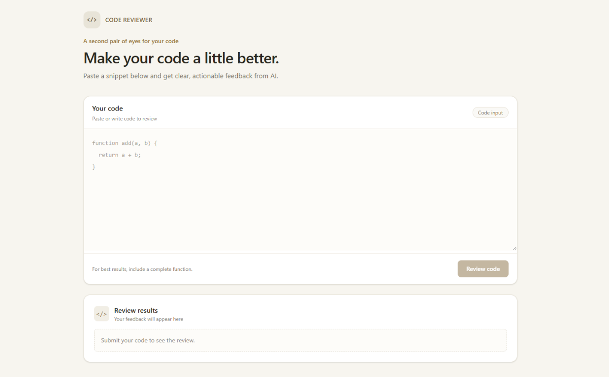

<div align="center">



# Code Reviewer

Paste a code snippet and get actionable AI-powered review feedback.

</div>

## About

Code Reviewer is a small full-stack app with a React and Tailwind CSS interface and an Express API. The server sends submitted code to Google Gemini and returns a review covering correctness, security, performance, and maintainability.

## Features

- Paste code into a simple editor.
- Request an AI-generated code review.
- See a loading indicator while the review is being generated.
- Read the result or an error message in the results panel.
- Keep the Gemini API key on the server.

## Tech stack

- **Client:** React, Vite, Tailwind CSS
- **Server:** Node.js, Express
- **AI:** Google Gemini via `@google/genai`

## Requirements

- Node.js and npm
- A Google Gemini API key

## Getting started

### 1. Configure the server

Create `server/.env` from the example:

```env
GEMINI_API_KEY=your_gemini_api_key
GEMINI_MODEL=gemini-flash-latest
```

Keep the API key private. Do not commit `server/.env`.

Install the server dependencies and start the API:

```bash
cd server
npm install
npm run dev
```

The API listens on `http://localhost:3000`.

### 2. Start the client

In another terminal:

```bash
cd client
npm install
npm run dev
```

Open the Vite URL shown in the terminal (by default, `http://localhost:5174`). The Vite development server proxies `/ai` requests to the API at `http://localhost:3000`.

## API

### `POST /ai/get-review`

Request:

```json
{
  "code": "function add(a, b) { return a + b; }"
}
```

Successful response:

```json
{
  "response": "AI-generated code review..."
}
```

The endpoint returns `400` if the code is missing or empty, and `502` if the AI service fails.

## Scripts

Run these commands from the corresponding `client` or `server` directory:

| Command | Project | Description |
| --- | --- | --- |
| `npm run dev` | Client | Start the Vite development server |
| `npm run build` | Client | Build the client for production |
| `npm run lint` | Client | Run Oxlint |
| `npm run preview` | Client | Preview the production build |
| `npm run dev` | Server | Start the Express API |

## Project layout

```text
.
├── client/                 # React frontend and Vite configuration
└── server/                 # Express API and Gemini integration
```
